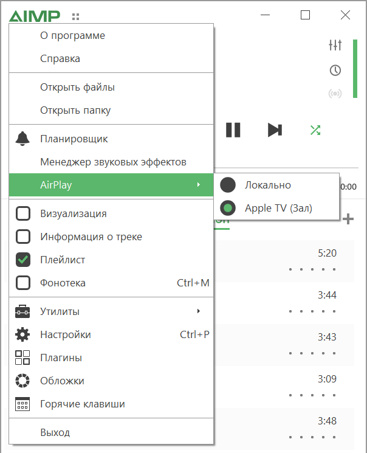

# AirPlay для AIMP

Нужны Windows x64, 64-разрядный AIMP и приёмник RAOP (AirPlay 1) в той же локальной сети,
включая приёмники AirPlay 2 с поддержкой этого режима.
Постоянный пароль на приёмнике должен быть выключен. Код с экрана Apple TV поддерживается;
приёмники с автоматической привязкой подключаются без ввода кода.

## Установка

1. Если скачан ZIP-архив, распакуйте его.
2. Откройте **aimp_airplay-….aimppack** двойным щелчком и подтвердите установку в AIMP. В открывшемся окне плагинов поставьте галочку напротив **AirPlay Sender** и нажмите **ОК**.
3. Откройте **dsp_airplay-….aimppack** двойным щелчком и подтвердите установку. В открывшемся окне плагинов поставьте галочку напротив **dsp_airplay** (**AirPlay PCM sender**) и нажмите **ОК**.
4. Перезапустите AIMP.
5. Откройте **Главное меню → Менеджер звуковых эффектов**. На вкладке **DSP/VST** поставьте галочку напротив **AirPlay PCM**.
6. Разрешите AIMP доступ в брандмауэре Windows. При появлении запроса нажмите **Разрешить доступ** для вашей сети. Если разрешение ещё не выдано и запрос не появляется:

   1. Откройте **Безопасность Windows → Брандмауэр и защита сети → Разрешить работу с приложением через брандмауэр** и нажмите **Изменить параметры**.
   2. Найдите AIMP. Если его нет, нажмите **Разрешить другое приложение** и выберите `AIMP.exe` в папке плеера.
   3. Отметьте для AIMP тип вашей сети: **Частная** или **Общедоступная**, затем нажмите **ОК**.

7. В главном меню откройте **AirPlay** и выберите приёмник.
8. Включите воспроизведение. Если Apple TV запросит код, введите в появившемся окне AIMP четыре цифры с экрана телевизора.

## Использование

Для смены приёмника откройте меню **AirPlay**. Для возврата звука на компьютер выберите **Локально**.

Пульт Apple TV позволяет поставить музыку на паузу, продолжить воспроизведение и переключить трек.
